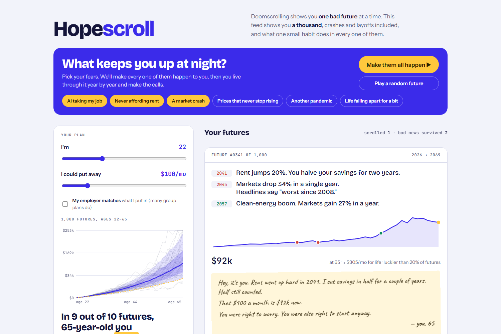

# Hopescroll

**Pick your biggest fears about the future. Hopescroll makes them all happen, then you live through them year by year and see that your choices matter more than your luck.**

Built for the Canada Life Future Me Challenge.

## What it does
- **Fear-picker stress test:** choose your fears (AI taking your job, rent, a crash, inflation, a pandemic, life emergencies), and they all happen to you.
- **Year-by-year game:** make the call at each shock (sell, hold or buy the dip; cash out or use the emergency fund; spend the raise or save it) while "Autopilot you" runs alongside.
- **You vs Autopilot you vs Doomscroll you:** the same world with the same luck, so the gap comes from decisions. Ends with badges and a postcard from 65-year-old you.
- **A feed of 1,000 futures:** a Monte Carlo fan chart plus individual futures you can scroll and play, with behavioural nudges and "Tiny Moves" built into the scroll.

## Run it
Open `docs/index.html` in any browser. It's one file with no build step, no backend, and no data leaving the device.

## Model
Real returns are drawn as N(4.5%, 10%) for a balanced portfolio after inflation, with 1–4 shocks per world, and are seeded so each future is reproducible. Income at 65 uses the 4% rule. All figures are illustrative, not financial advice.
